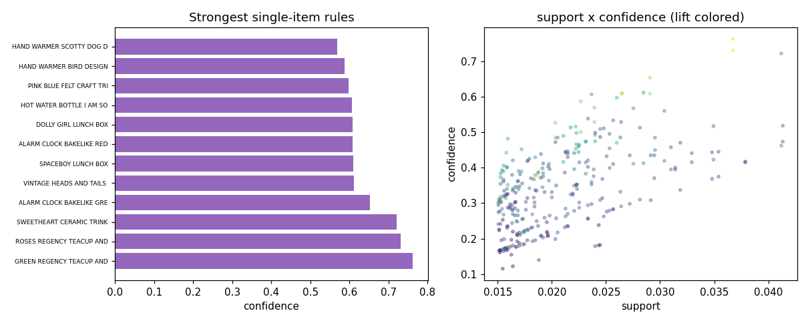

# Retail Market Basket Analysis

Apriori association rules on 15,000 grocery-retail baskets, read for lift rather than for support.

**Built:** October 2026

## The question

Which products are bought together often enough to be worth merchandising as a pair, and how strong is that co-occurrence compared with what independent buying would produce?

## Data

- **UCI Online Retail II** - 15,000 baskets sampled from the UK subset (complete source file, 1,067,371 transactions)
- Source: https://archive.ics.uci.edu/dataset/502/online+retail+ii (CC BY 4.0)
- Invoices with 2 to 40 line items, top 120 descriptions by frequency. The qualifying pool is 22,852 baskets, of which 15,000 are sampled with a fixed seed. Cancelled and non-numeric stock codes removed.

## Method

- Transaction encoding of basket membership
- Apriori with min_support 0.015, max itemset length 4
- Rules filtered on lift > 1.6, single-antecedent rules ranked by confidence
- Support-by-confidence scatter for the whole rule set

## Results

| Metric | Value |
|---|---|
| invoices_analysed | 15000 |
| catalogue_size | 120 |
| frequent_itemsets | 270 |
| rules_min_lift_1_6 | 306 |
| max_confidence | 0.7632 |
| max_lift | 15.9640 |
| median_basket_size | 5.0000 |

### Top association rules by confidence

| if bought | then also | support | confidence | lift |
|---|---|---|---|---|
| GREEN REGENCY TEACUP AND SAUCER | ROSES REGENCY TEACUP AND SAUCER | 0.0367 | 0.763 | 15.18 |
| ROSES REGENCY TEACUP AND SAUCER | GREEN REGENCY TEACUP AND SAUCER | 0.0367 | 0.731 | 15.18 |
| SWEETHEART CERAMIC TRINKET BOX | STRAWBERRY CERAMIC TRINKET BOX | 0.0412 | 0.722 | 8.1 |
| ALARM CLOCK BAKELIKE GREEN | ALARM CLOCK BAKELIKE RED | 0.0291 | 0.654 | 13.69 |
| VINTAGE HEADS AND TAILS CARD GAME | VINTAGE SNAP CARDS | 0.0285 | 0.612 | 8.87 |
| SPACEBOY LUNCH BOX | DOLLY GIRL LUNCH BOX | 0.0265 | 0.61 | 14.03 |
| ALARM CLOCK BAKELIKE RED | ALARM CLOCK BAKELIKE GREEN | 0.0291 | 0.609 | 13.69 |
| DOLLY GIRL LUNCH BOX | SPACEBOY LUNCH BOX | 0.0265 | 0.609 | 14.03 |
| HOT WATER BOTTLE I AM SO POORLY | CHOCOLATE HOT WATER BOTTLE | 0.0237 | 0.607 | 9.24 |
| PINK BLUE FELT CRAFT TRINKET BOX | PINK CREAM FELT CRAFT TRINKET BOX | 0.026 | 0.597 | 10.81 |
| HAND WARMER BIRD DESIGN | HAND WARMER OWL DESIGN | 0.0227 | 0.587 | 12.97 |
| HAND WARMER SCOTTY DOG DESIGN | HAND WARMER OWL DESIGN | 0.0239 | 0.57 | 12.59 |



*Rule strength and the support-confidence trade-off*

## What the numbers mean

The useful reading is that high-confidence rules here are mostly gifts clustering around a single seasonal hero product, which is a bundling signal rather than a cross-sell signal. Lift is the column that separates the two, and the highest-confidence rules are not the highest-lift ones.

## Limitations

Sampling 15,000 of 22,852 qualifying baskets means rules are unstable at the margin; support 0.015 on this size is 225 baskets. Description text is used as the item identity, and near-duplicate descriptions are not merged. Basket composition is influenced by promotions that the file does not flag.

## Run it

    pip install -r requirements.txt
    python src/main.py

```
python src/main.py            # requires the dataset in data/ (see data/README.md)
```

## License

MIT
